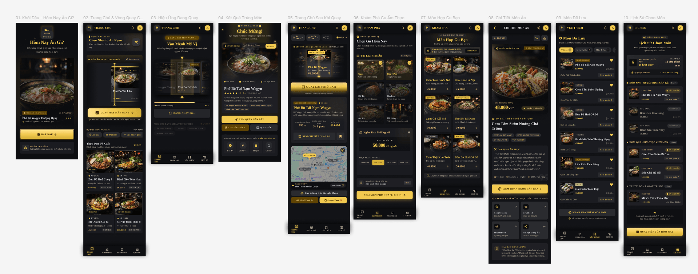
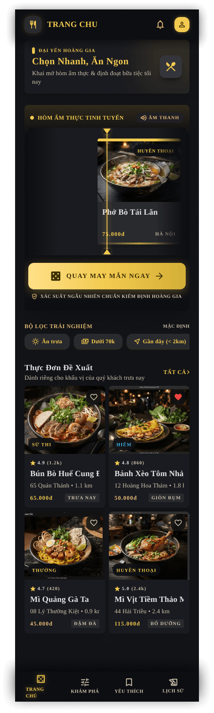
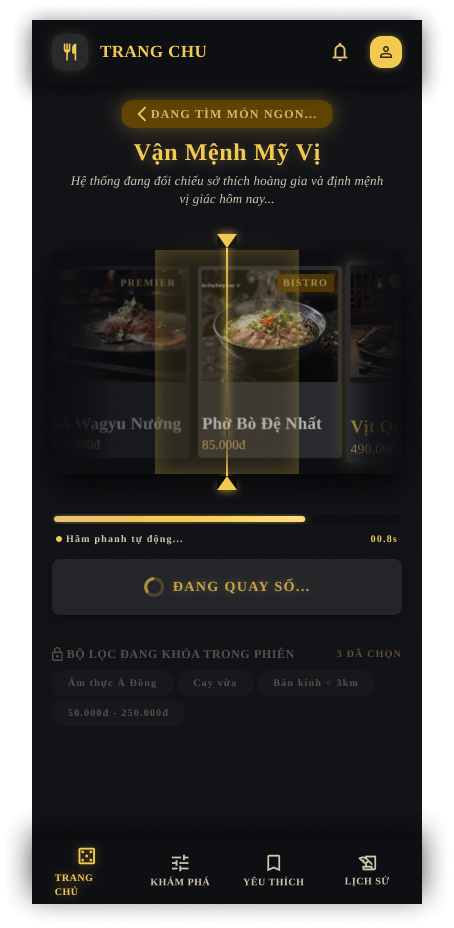
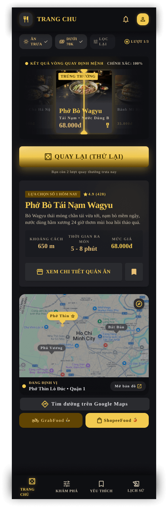
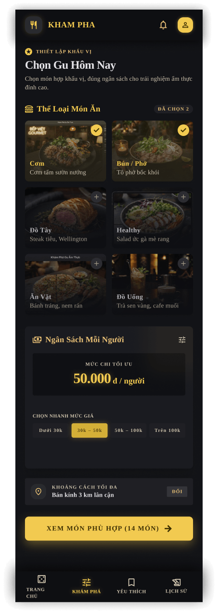
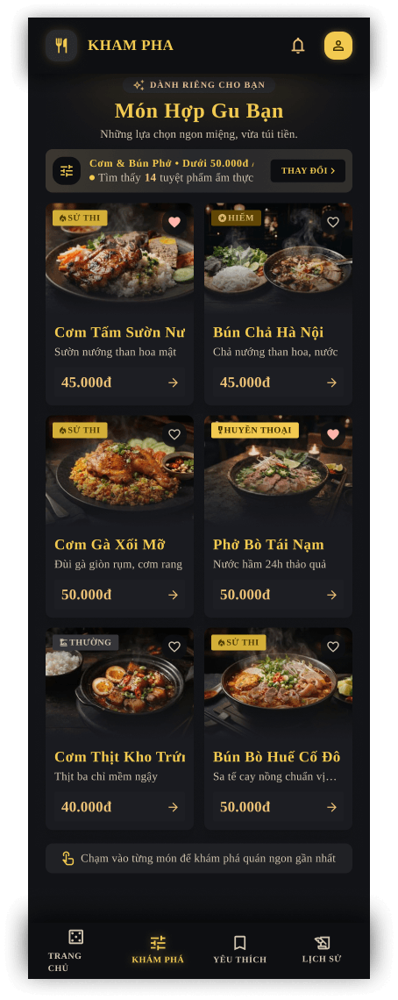
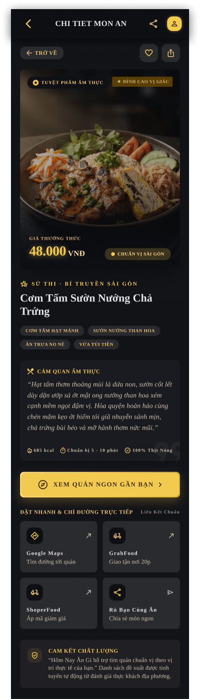
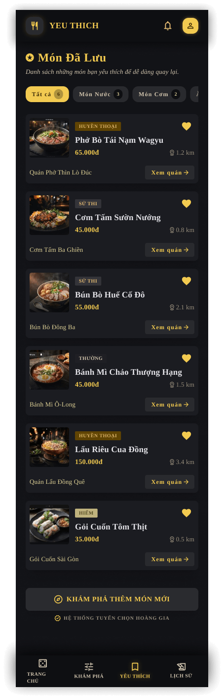
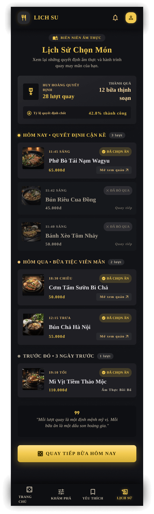

# Thiết kế Figma

- Tên file: **Hôm nay ăn gì – ADR** 
- Đường dẫn: [\[ link Figma \]](https://www.figma.com/design/K2jr74HvZCG6bCB3WtMJ5J/H%C3%B4m-nay-%C4%83n-gif?node-id=0-1&t=dSFqmcf7LnGwIAiL-0)
- Quyền truy cập:  chế độ "Anyone with the link can view" 

## Danh sách màn hình

| STT | Màn hình |
|---|---|
01 | Khởi Đầu - Hôm Nay Ăn Gì?
02 | Trang Chủ & Vòng Quay CS2 
03 | Hiệu Ứng Đang Quay 
04 | Kết Quả Trúng Món
05 | Trang Chủ Sau Khi Quay
06 | Khám Phá Gu Ẩm Thực 
07 | Món Hợp Gu Bạn
08 | Chi Tiết Món Ăn
09 | Món Đã Lưu 
10 | Lịch Sử Chọn Món

Ảnh xuất từ Figma của từng màn hình nằm trong thư mục [screenshots/](screenshots/).

         
